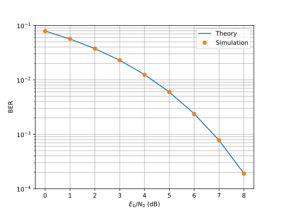

# BER of binary antipodal signaling

The bit error rate (BER) of binary antipodal signaling over the additive white Gaussian noise (AWGN) channel is
$$
    P_\mathrm{b} = \mathrm{Q} \left( \sqrt{2 E_\mathrm{b} / N_0} \right),
$$
where $\mathrm{Q}$ is the [Gaussian Q-function](/ref/gaussian_q). Binary phase-shift keying (BPSK) has the same BER. The simulation below confirms this formula.

Binary antipodal signaling uses the [PAM constellation](/ref/PAMConstellation) of order $2$, with points $\pm 1$, so that $E_\mathrm{b} = 1$. The [Gaussian channel](/ref/GaussianChannel) then has noise power $N_0 / 2 = 1 / (2 E_\mathrm{b} / N_0)$. The bits, from a [discrete memoryless source](/ref/DiscreteMemorylessSource), serve directly as indices of the constellation points, and the receiver picks the closest point. Estimating a lower BER takes more bits, so each point simulates blocks of $10^6$ bits until it counts at least $100$ errors, which keeps the relative error of each estimate at most about $1/\sqrt{100} = 10\%$.

```pycon
>>> import numpy as np
>>> import komm

>>> rng = np.random.default_rng(seed=42)
>>> komm.global_rng.set(rng)

>>> source = komm.DiscreteMemorylessSource(2)
>>> constellation = komm.PAMConstellation(2)
>>> ebn0_db = np.arange(11)
>>> ebn0 = 10 ** (ebn0_db / 10)
>>> ber = []
>>> for noise_power in 1 / (2 * ebn0):
...     channel = komm.GaussianChannel(noise_power)
...     num_errors = num_bits = 0
...     while num_errors < 100:
...         bits = source.emit(1_000_000)
...         symbols = constellation.indices_to_symbols(bits)
...         received = channel.transmit(symbols)
...         bits_hat = constellation.closest_indices(received)
...         num_errors += np.sum(bits != bits_hat)
...         num_bits += bits.size
...     ber.append(num_errors / num_bits)

>>> ber_theory = komm.gaussian_q(np.sqrt(2 * ebn0))

```

To plot the curves, with [Matplotlib](https://matplotlib.org), and the BER of $10^{-5}$ as a dashed line:

```python
import matplotlib.pyplot as plt

fig, ax = plt.subplots()
ax.semilogy(ebn0_db, ber_theory, label="Theory")
ax.semilogy(ebn0_db, ber, "o", label="Simulation")
ax.axhline(1e-5, color="k", ls="--")
ax.set(xlabel=r"$E_\mathrm{b}/N_0$ (dB)", ylabel="BER", ylim=(1e-6, 1e-1))
ax.set_xticks(ebn0_db)
ax.grid(which="both")
ax.legend()
plt.show()
```

<figure markdown>
  
</figure>

Inverting the formula gives the $E_\mathrm{b} / N_0$ needed for a target BER:
$$
    E_\mathrm{b} / N_0 = \frac{1}{2} \left( \mathrm{Q}^{-1}(P_\mathrm{b}) \right)^2,
$$
where $\mathrm{Q}^{-1}$ is the [inverse of the Gaussian Q-function](/ref/gaussian_q_inv). For $P_\mathrm{b} = 10^{-5}$, a common target when comparing channel codes, it is about $9.6$ dB, where the theory curve crosses the dashed line:

```pycon
>>> from math import log10

>>> 10 * log10(komm.gaussian_q_inv(1e-5) ** 2 / 2)  # doctest: +FLOAT_CMP
9.587858346847609

```
